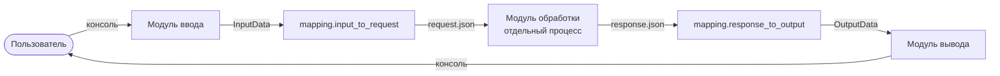

# Интеграция модулей проекта «МатрСум-11»

Документ описывает, как модули проекта (ЛР №1 — ТЗ, ЛР №2 — структура
репозитория) объединены в единую систему в ЛР №3.

- Вариант интеграции: **риск-ориентированная** (вариант 11 задания).
- Протокол: **обмен JSON-сообщениями через файлы**.
- Версия протокола: **1.0**, версия системы: **v1.0.0**.

## 1. Архитектура взаимодействия

Монолитная программа из ЛР №2 (`src/matrsum.py`) разделена на три модуля
и интеграционный слой.

| Модуль | Файл | Назначение |
| --- | --- | --- |
| Ввод | `src/input_module.py` | чтение n, m и элементов, проверка данных |
| Обработка | `src/processing_module.py` | поиск столбцов с нулём, сумма их элементов |
| Вывод | `src/output_module.py` | форматирование результата (3 знака) |
| Протокол | `src/protocol.py` | формат и проверка JSON-сообщений, чтение/запись файлов |
| Сопоставление | `src/mapping.py` | структуры данных модулей и их преобразование |
| Ошибки | `src/errors.py` | иерархия исключений интеграции |
| Интеграция | `src/matrsum.py` | точка входа, запуск модуля обработки, повторы, тайм-аут |



Модуль обработки запускается отдельным процессом
(`python src/processing_module.py --request ... --response ...`), поэтому
для него возможны недоступность и тайм-аут, а обмен происходит только через
файлы `request.json` и `response.json`.

## 2. Стратегия интеграции

Выбрана **риск-ориентированная** стратегия: первыми подключаются модули и
связи с наибольшим риском. Оценка: вероятность ошибки (1–3) × влияние (1–3).

| № | Риск | В × Вл | Оценка | Шаг |
| --- | --- | --- | --- | --- |
| R1 | Обработка: сравнение вещественных с нулём, точность суммирования | 3 × 3 | 9 | 1 |
| R2 | Канал обмена: JSON-формат, процесс, тайм-аут, версии | 3 × 2 | 6 | 2 |
| R3 | Ввод: некорректные данные пользователя | 2 × 2 | 4 | 2 |
| R4 | Вывод: форматирование (простая логика) | 2 × 1 | 2 | 3 |

Порядок интеграции:

1. **Шаг 1 (R1).** Модуль обработки + *драйвер* (`tests/helpers.py`,
   `processing_driver`), который вместо модуля ввода отправляет JSON-запросы
   из `tests/data/cases.json`.
2. **Шаг 2 (R2, R3).** Модуль ввода подключается к обработке через
   JSON-файлы; модуль вывода заменён *заглушкой* (`OutputStub`).
3. **Шаг 3 (R4).** Подключается модуль вывода, заглушка убирается,
   добавляется точка входа `matrsum.py`.
4. **Шаг 4.** Обработка исключительных ситуаций (недоступность, тайм-аут,
   некорректные данные, конфликт версий).

## 3. Протокол и форматы

Все сообщения — JSON (UTF-8) в одном «конверте»:

```json
{"version": "1.0", "type": "<тип>", "payload": {}}
```

| Тип | Направление | Поля payload |
| --- | --- | --- |
| `matrix_request` | ввод → обработка | `rows`, `cols`, `matrix` |
| `sum_response` | обработка → вывод | `zero_columns` (номера с 1), `sum` |
| `error` | обработка → интеграционный слой | `code`, `message` |

Коды ошибок: `invalid_data`, `protocol_error`, `version_conflict`.

Правила совместимости: сообщения с одинаковым номером *major* совместимы
(`1.0` и `1.7`), другой *major* — конфликт версий.

Коды завершения модуля обработки: `0` — успех, `10` — в файл ответа записано
сообщение `error`, любой другой — сбой модуля (недоступен).

Коды завершения программы: `0` — успех, `1` — ошибка данных, `2` — ошибка
интеграции.

## 4. Сопоставление объектов данных (mapping)

| Источник | Приёмник (JSON) | Преобразование |
| --- | --- | --- |
| `InputData.n` (int) | `payload.rows` | прямое сопоставление |
| `InputData.m` (int) | `payload.cols` | прямое сопоставление |
| `InputData.matrix` (list[list[float]]) | `payload.matrix` | копирование строк |
| Ввод пользователя `"1,5"` | `float` | нормализация: запятая → точка |
| индекс столбца с 0 (обработка) | `payload.zero_columns` (с 1) | `j + 1` |
| сумма (`float`, `math.fsum`) | `payload.sum` | приведение к `float` |
| `payload.zero_columns` (list) | `OutputData.columns` (tuple) | преобразование типа |
| `payload.sum` | `OutputData.total` | `float`; округление — в модуле вывода |

## 5. Примеры запросов и ответов

Запрос `request.json` (матрица 3 × 4):

```json
{
  "version": "1.0",
  "type": "matrix_request",
  "payload": {
    "rows": 3,
    "cols": 4,
    "matrix": [
      [1.0, 0.0, 2.0, 5.0],
      [3.0, 4.0, 0.0, 6.0],
      [7.0, 8.0, 9.0, 1.0]
    ]
  }
}
```

Ответ `response.json`:

```json
{
  "version": "1.0",
  "type": "sum_response",
  "payload": {
    "zero_columns": [2, 3],
    "sum": 23.0
  }
}
```

Ответ на запрос с версией `2.0`:

```json
{
  "version": "1.0",
  "type": "error",
  "payload": {
    "code": "version_conflict",
    "message": "несовместимая версия протокола 2.0, поддерживается 1.x"
  }
}
```

## 6. Обработка исключительных ситуаций

| Ситуация | Как обнаруживается | Исключение | Реакция |
| --- | --- | --- | --- |
| Модуль недоступен | файл не найден, код завершения не 0/10, нет файла ответа | `ModuleUnavailableError` | повтор (`DEFAULT_ATTEMPTS = 2`), затем код 2 |
| Тайм-аут | `subprocess.TimeoutExpired` | `ModuleTimeoutError` | повтор, затем код 2 |
| Некорректные данные | проверка в модуле ввода и в `parse_request` | `InputDataError` | сообщение, код 1 |
| Нарушен формат | неверный JSON, нет полей, неверный тип | `ProtocolError` | сообщение, код 2 |
| Конфликт версий | другой major в `version` | `VersionConflictError` | сообщение, код 2 |

## 7. Запуск

```bash
python src/matrsum.py                       # файлы обмена во временном каталоге
python src/matrsum.py --workdir exchange    # сохранить request.json/response.json
python src/matrsum.py --timeout 5           # тайм-аут модуля обработки, с
python -m unittest discover -s tests -v     # все тесты
```
